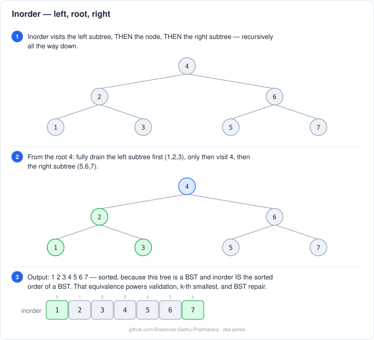

# Binary Tree Inorder Traversal

> Striver SDE Sheet 104 · Day 17 Binary Tree — iterative with an explicit stack: slide down the left spine, visit, turn right. Go, stdlib only, tested.

## Problem

Visit a binary tree left-subtree → root → right-subtree, returning the values in order. Recursion is three lines; the sheet wants the *iterative* version, because managing the stack yourself is what the follow-ups (BST iterator, Morris) build on.

## Approach

The explicit stack holds the path of ancestors whose left side is done being descended but not yet visited. The loop has exactly two moves: slide down the left spine pushing everything, then pop one node, *visit it*, and step into its right subtree — where the spine-slide resumes. The loop condition `cur != nil || len(stack) > 0` covers both "still descending" and "still unwinding". On a BST this emits sorted order, which is why inorder is the backbone of half the BST problems later in the sheet.

**Complexity:** O(n) time, O(h) stack (h = tree height).

## Visual walkthrough

Read the picture top to bottom — each numbered frame is one moment of the algorithm
running on this repo's test example.

## Run

    go test ./...   # verify
    go run .        # demo

---

One of 191 repos solving Striver's SDE Sheet in Go — stdlib only, one problem per repo, every solution tested. Browse the set: [`dsa-*` repos](https://github.com/Sreenivas-Sadhu-Prabhakara?tab=repositories&q=dsa-&type=source).
